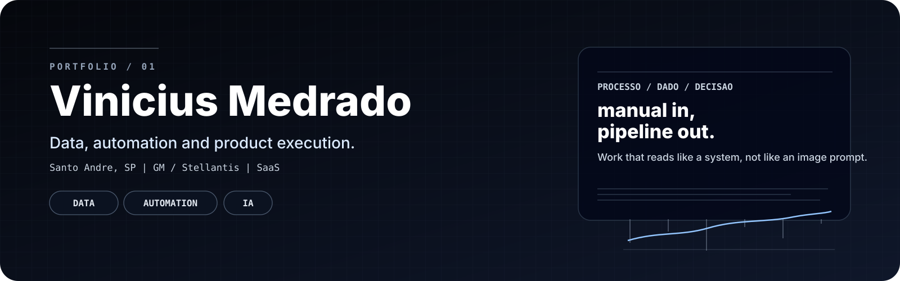

### Data & Automation | Python · SQL · ETL/ELT · FastAPI · Power BI · APIs

**Turning manual workflows and fragmented data into reliable, testable solutions.**

[Portfolio — English](https://vinmedrado.com/index-en.html) · [Portafolio — Español](https://vinmedrado.com/index-es.html) · [LinkedIn](https://www.linkedin.com/in/viniciusmedrado/) · [Email](mailto:vinicius.medrado@outlook.com)

## About me

I'm a **Data Analyst & Automation professional** based in Brazil, with 4+ years of experience building automations and working across data, reporting, APIs and operational systems. I design practical solutions end to end—from collection and transformation to validation, dashboards and user-facing applications.

My main interests are **data engineering, workflow automation, ETL/ELT, API integrations and production-minded software engineering**. I'm developing my career for international opportunities, especially in Spain.

**Professional impact** *(work experience; not benchmarks of the public repositories)*:

- Reduced a recurring **daily NPS reporting workflow from 13 minutes to approximately 20 seconds** using Python (~97% time reduction).
- Reduced a Power BI semantic model from **158 MB to 56 MB** while preserving historical data.
- Delivered operational automation, data quality checks and reporting workflows used in a corporate Customer Experience context.

These results are described in more detail in my [English portfolio](https://vinmedrado.com/index-en.html).

## Selected engineering projects

### 01 · [Marketplace Seller Platform](https://github.com/vinmedrado/marketplace-seller-platform) — Marketplace data and pricing intelligence

**Python · FastAPI · PostgreSQL · React · TypeScript · ETL · ML**

A full-stack marketplace operations project covering product management, pricing, integrations and analytical workflows. It separates a **public demonstration with synthetic data** from a **private authenticated operations console**.

- **Engineering:** layered services, data pipelines, schema migrations and explainable pricing with rule-based fallback.
- **Reliability:** CI covers backend tests, migrations, privacy checks, and frontend builds.
- **Security boundary:** authenticated, tenant-scoped product operations; public demo is isolated from production credentials.
- [Live demo](https://vinmedrado.github.io/marketplace-seller-platform/) · [Case study (EN/ES)](https://github.com/vinmedrado/marketplace-seller-platform/blob/main/docs/RECRUITER_CASE_STUDY.md) · [Source](https://github.com/vinmedrado/marketplace-seller-platform) · [CI](https://github.com/vinmedrado/marketplace-seller-platform/actions/workflows/ci.yml)

### 02 · [Vinance](https://github.com/vinmedrado/vinance) — Financial operations and analytics

**Python · FastAPI · PostgreSQL · Redis · Celery · React · TypeScript**

A modular financial application combining financial records, budgeting, investment analysis, background processing and decision-support features.

- **Engineering:** API and domain modules, asynchronous jobs, data services and analytical workflows.
- **Architecture:** React/Vite is the primary frontend; Streamlit is retained for legacy administration.
- **Validation:** backend tests, frontend build and Docker Compose configuration checks run in CI.
- [Case study (EN/ES)](https://github.com/vinmedrado/vinance/blob/main/docs/RECRUITER_CASE_STUDY.md) · [Source](https://github.com/vinmedrado/vinance) · [CI](https://github.com/vinmedrado/vinance/actions/workflows/ci.yml)

### 03 · [Meu Carro Vale](https://github.com/vinmedrado/meu-carro-vale) — Vehicle valuation and market data

**Python · FastAPI · PostgreSQL · React · TypeScript · Data Engineering**

An automotive valuation project combining FIPE reference data, available market comparables, pricing insights, a guided workflow and an exportable PDF report.

- **Engineering:** frontend, backend and data-engine in separate modules, with data-source fallback.
- **Validation:** backend, data-engine and frontend CI passed; browser smoke checks covered demonstration navigation and reporting on desktop and mobile.
- **Important:** the public demonstration uses illustrative values and is **not** a live valuation quote.
- [Live demo](https://vinmedrado.github.io/meu-carro-vale/) · [Case study (EN/ES)](https://github.com/vinmedrado/meu-carro-vale/blob/main/docs/RECRUITER_CASE_STUDY.md) · [Source](https://github.com/vinmedrado/meu-carro-vale) · [CI](https://github.com/vinmedrado/meu-carro-vale/actions/workflows/ci.yml)

### 04 · Pilar — Language-learning PWA *(private repository)*

**SvelteKit · TypeScript · IndexedDB · Supabase · PostgreSQL · Edge Functions**

A progressive Spanish/English learning application with independent learning paths, spaced repetition, guided activities, offline-first functionality and AI-assisted practice.

- **Engineering:** local persistence and optional cloud synchronization, authenticated data access and server-side AI integrations.
- **Validation:** 62 automated Vitest cases plus domain/content suites, TypeScript checks, production build and browser-based offline/mobile smoke checks.
- **Source is private.** [Read the public technical case study (EN/ES)](docs/PILAR_CASE_STUDY.md); it does not expose the repository or student data.

## How I approach engineering

- **Data quality:** validate inputs and outputs before publishing reports or downstream datasets.
- **Automation:** optimize repetitive processes while keeping error handling and observability visible.
- **Maintainability:** separate domain logic, data access and user interfaces.
- **Testing:** use automated checks to prevent regressions, while documenting what they do *not* cover.
- **Privacy:** isolate public demos from real accounts, tokens and sensitive data.

The projects are portfolio and learning initiatives; their passing CI checks do **not** imply exhaustive security testing or production certification.

---

## En español — Perfil profesional

Soy **analista de datos y automatización**, con más de cuatro años de experiencia en automatización de procesos, Python, SQL, integraciones mediante APIs e inteligencia de negocio. Me interesa especialmente la **ingeniería de datos**, la calidad de la información y el desarrollo de soluciones fiables que conecten sistemas y equipos.

En mi experiencia profesional, automaticé un proceso diario de informes NPS, reduciendo el tiempo de ejecución de **13 minutos a aproximadamente 20 segundos**, y optimicé un modelo semántico de Power BI de **158 MB a 56 MB**.

**Proyectos destacados:**

- **[Marketplace Seller Platform](https://github.com/vinmedrado/marketplace-seller-platform):** integración de datos, inteligencia comercial, precios y arquitectura multiusuario.
- **[Vinance](https://github.com/vinmedrado/vinance):** plataforma financiera con API, procesos asíncronos y análisis de datos.
- **[Meu Carro Vale](https://github.com/vinmedrado/meu-carro-vale):** valoración de vehículos con referencias FIPE, datos de mercado e informes PDF.
- **Pilar (repositorio privado):** aplicación PWA para aprender español e inglés con repaso espaciado y funcionamiento sin conexión.

Mi objetivo profesional es seguir creciendo en **datos, automatización e ingeniería de datos** en equipos internacionales.

[Ver portafolio en español](https://vinmedrado.com/index-es.html) · [LinkedIn](https://www.linkedin.com/in/viniciusmedrado/)

---

**Contact:** [vinicius.medrado@outlook.com](mailto:vinicius.medrado@outlook.com) · [Portfolio](https://vinmedrado.com) · [All repositories](https://github.com/vinmedrado?tab=repositories)
